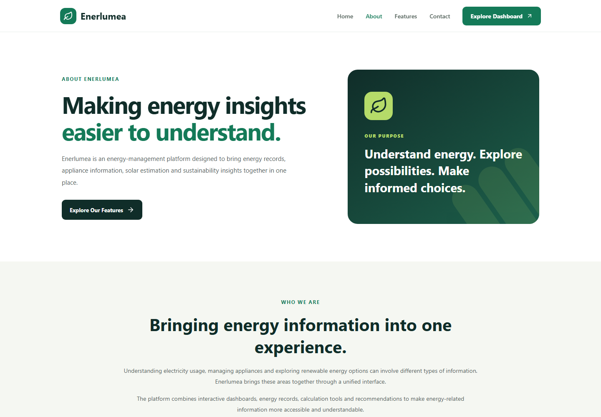
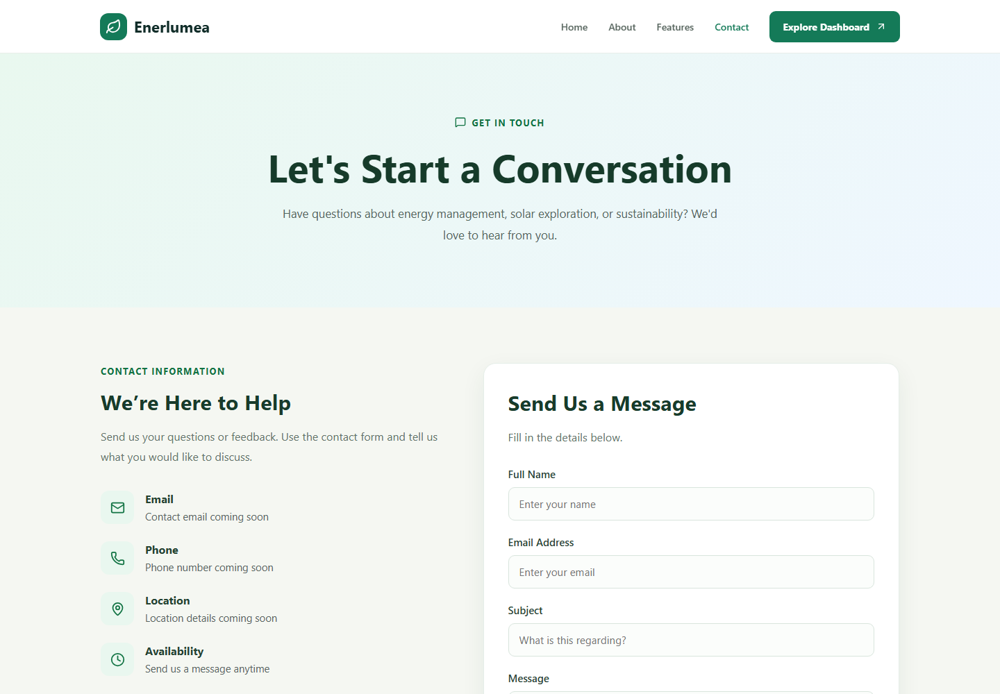
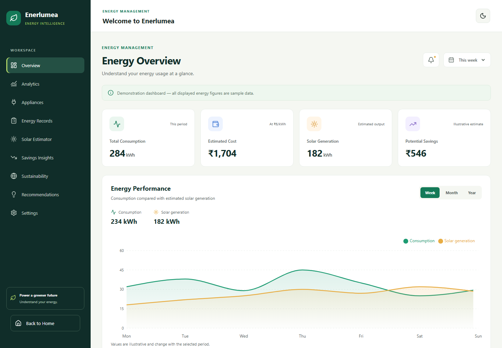
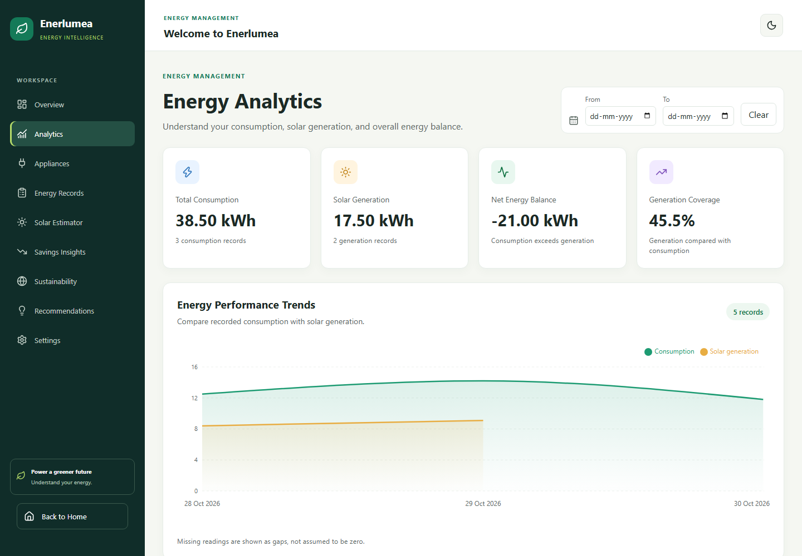
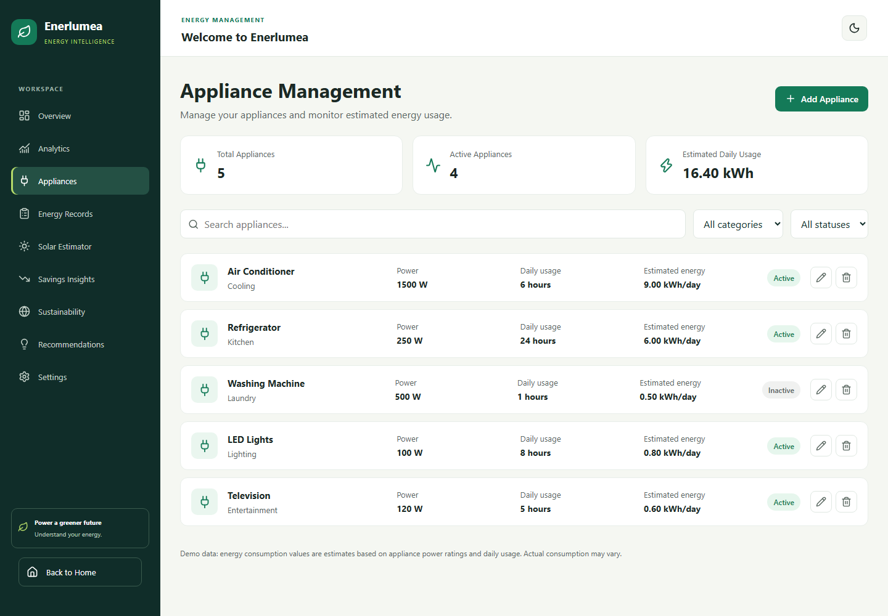
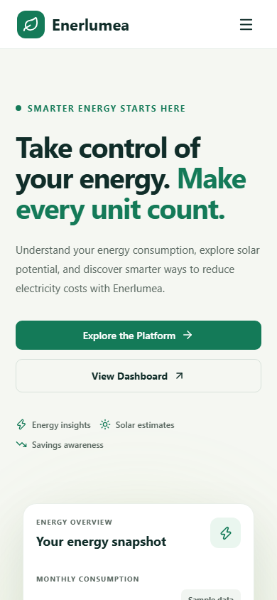
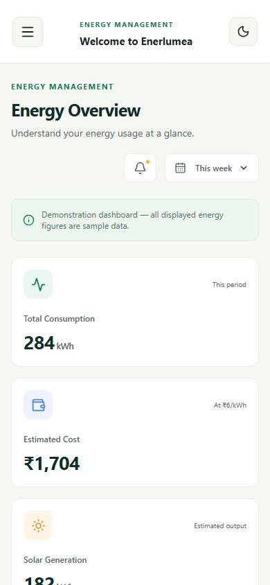

# Enerlumea

Enerlumea is a household energy management application built with React and
Vite, backed by a Spring Boot API. It helps users review appliance and energy
records, explore solar estimates, and submit contact messages. The API stores
data in a local H2 database during development.

## Run locally

You need Node.js, npm, and Java/Maven installed. From the repository root,
start the API and frontend in separate terminals:

```powershell
mvn.cmd -f backend/pom.xml spring-boot:run
npm.cmd run dev
```

The API listens on `http://localhost:8080`; Vite proxies `/api` requests to it.
On its first run, the API seeds demonstration appliances and energy readings
when the database is empty. H2 data is stored under `backend/data/` and
persists across API restarts.

To host the frontend and API separately, set `VITE_API_BASE_URL` to the API
base path (for example, `https://api.example.com/api`) and configure
`CORS_ALLOWED_ORIGINS` on the API with the frontend origin or a comma-separated
list of allowed origins.

## API

| Method | Path | Purpose |
| --- | --- | --- |
| `GET` | `/api/appliances` | List appliances |
| `POST` | `/api/appliances` | Add an appliance |
| `PUT` | `/api/appliances/{id}` | Update an appliance |
| `DELETE` | `/api/appliances/{id}` | Delete an appliance |
| `GET` | `/api/energy-records` | List energy readings |
| `POST` | `/api/energy-records` | Add an energy reading |
| `PUT` | `/api/energy-records/{id}` | Update an energy reading |
| `DELETE` | `/api/energy-records/{id}` | Delete an energy reading |
| `POST` | `/api/contact-messages` | Validate and store a contact submission |

Contact submissions are stored in the database; the API does not send email.
The API does not currently provide authentication and is intended for local
development. Configure authentication and a production database before
exposing it publicly.

## Development checks

Run these commands from the repository root:

```powershell
npm.cmd audit --audit-level=moderate
npm.cmd run lint
npm.cmd run test:run
npm.cmd run test:browser
mvn.cmd -f backend/pom.xml test
npm.cmd run build
```

The first local browser-test run requires Playwright browser binaries:

```powershell
npx.cmd playwright install chromium firefox webkit
```

GitHub Actions runs the project checks for pushes and pull requests.

## Performance and quality snapshot

The recorded production build transferred about 90.45 KB of gzipped JavaScript
for the initial page, including an 83.73 KB entry bundle, shared runtime,
homepage code, and icon chunks. The 106.30 KB gzipped Recharts bundle is loaded
only on chart routes. These are build-time measurements, not a guarantee of
current Lighthouse scores.

The latest saved Lighthouse reports are:

| Device | Performance | Accessibility | Best Practices | SEO | Report |
| --- | ---: | ---: | ---: | ---: | --- |
| Mobile | 97 | 100 | 100 | 100 | [Mobile report](lighthouse/lighthouse-mobile.json) |
| Desktop | 100 | 100 | 100 | 100 | [Desktop report](lighthouse/lighthouse-desktop.json) |

These reports were captured locally on November 6, 2026, and contain no
Lighthouse run warnings. Scores are snapshots of those runs, not guarantees
about future builds.

Responsive viewport results are documented in the
[mobile responsiveness report](docs/mobile-responsiveness.md). Automated
viewport checks do not replace testing on physical devices.

## PWA and SEO

The frontend includes a web app manifest, a service worker for the application
shell, social-preview metadata, structured data, `robots.txt`, and a sitemap.
Before deployment, replace `YOUR-PRODUCTION-DOMAIN` in `public/robots.txt` and
`public/sitemap.xml` with the public frontend URL. Add canonical and Open Graph
URL metadata once the production domain is known.

The dashboard defaults to the light theme and stores the selected theme in the
current browser. Sign-in and cross-device preference synchronization are not
implemented.

## Screenshots

Desktop captures use a 1440 × 1000 viewport; mobile captures use a
390 × 844 viewport.

| Page | Screenshot |
| --- | --- |
| About |  |
| Contact |  |
| Dashboard overview |  |
| Dashboard analytics |  |
| Dashboard appliances |  |
| Home (mobile) |  |
| Dashboard (mobile) |  |

## Architecture

See the [architecture overview](docs/architecture.md) for the client, API,
and local database layout.

Additional project documentation:

- [Project overview](docs/project-overview.md)
- [Component hierarchy](docs/component-hierarchy.md)
- [Design decisions](docs/design-decisions.md)
- [Setup guide](docs/setup-guide.md)

## Component library

The private `@enerlumea/ui` workspace package contains reusable Button, Card,
and TextField components with separate styles and tests. The dashboard
Settings page uses the Card component. See the
[component library guide](packages/ui/README.md).

## Quality reports

- [Accessibility audit](docs/accessibility-audit.md)
- [Cross-browser test report](docs/cross-browser-testing.md)
