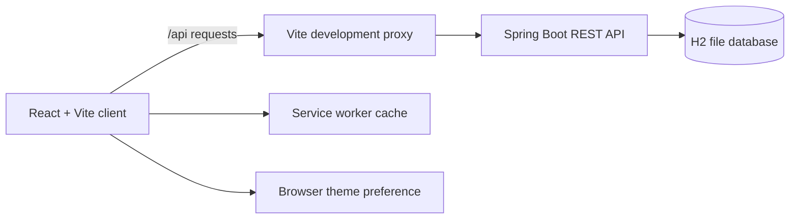

# Architecture overview

## Client

The React application uses route-level lazy loading for non-home routes.
Recharts is loaded only on pages that display energy charts. The dashboard
theme defaults to light and is saved in browser local storage.

The overview chart and summary metrics use illustrative sample data.
Appliance and energy-record management use the API. The API client uses
`/api` by default, or `VITE_API_BASE_URL` when the frontend and API are hosted
separately.

## API and storage

The Spring Boot API provides create, read, update, and delete operations for
appliances and energy records, and stores contact form submissions. In the
local profile, H2 persists data under `backend/data/`.

## Deployment requirements

Deploy the frontend and API behind HTTPS. Configure `VITE_API_BASE_URL`,
`CORS_ALLOWED_ORIGINS`, a production database, and authentication before
public use. Replace `YOUR-PRODUCTION-DOMAIN` in `public/robots.txt` and
`public/sitemap.xml` with the deployed frontend URL. Add canonical and social
preview URLs to the page metadata once the production domain is known.
