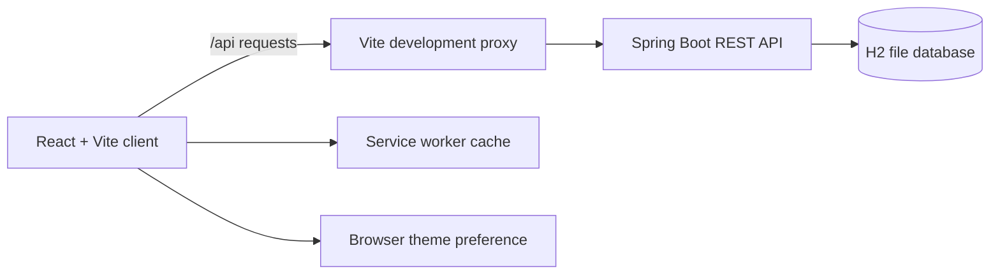

# Architecture

## Client

The React application uses route-level lazy loading. Recharts is loaded only for pages that render an energy chart. Dashboard theme preference defaults to light and is stored in browser local storage. The overview chart and summary metrics use illustrative sample data; appliance and energy-record management use the API. The API client uses `/api` by default or `VITE_API_BASE_URL` when the frontend and API are hosted separately.

## API

The Spring Boot API exposes appliance and energy-record CRUD endpoints and stores contact form submissions. The local profile persists data in `backend/data/` using H2.

## Deployment requirements

Deploy the frontend and API behind HTTPS. Set `VITE_API_BASE_URL`, `CORS_ALLOWED_ORIGINS`, a production database, and authentication before public use. Replace `YOUR-PRODUCTION-DOMAIN` in `public/robots.txt` and `public/sitemap.xml` with the deployed frontend URL, then add canonical and social preview URLs to the page metadata.
